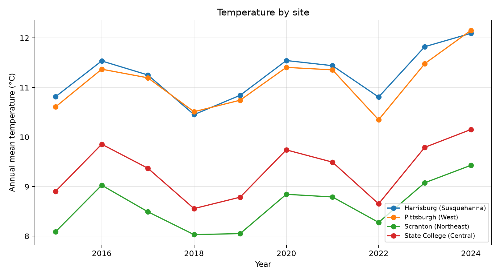
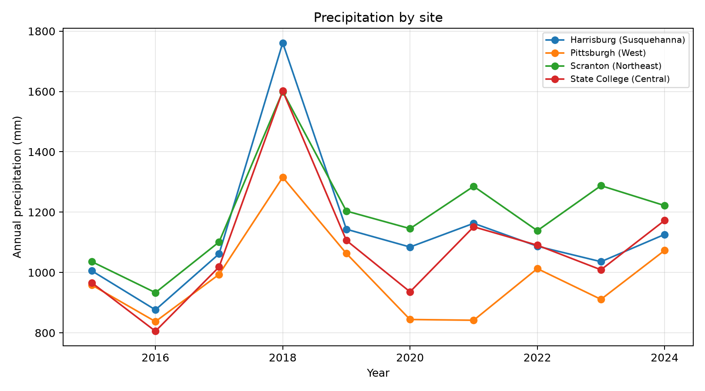
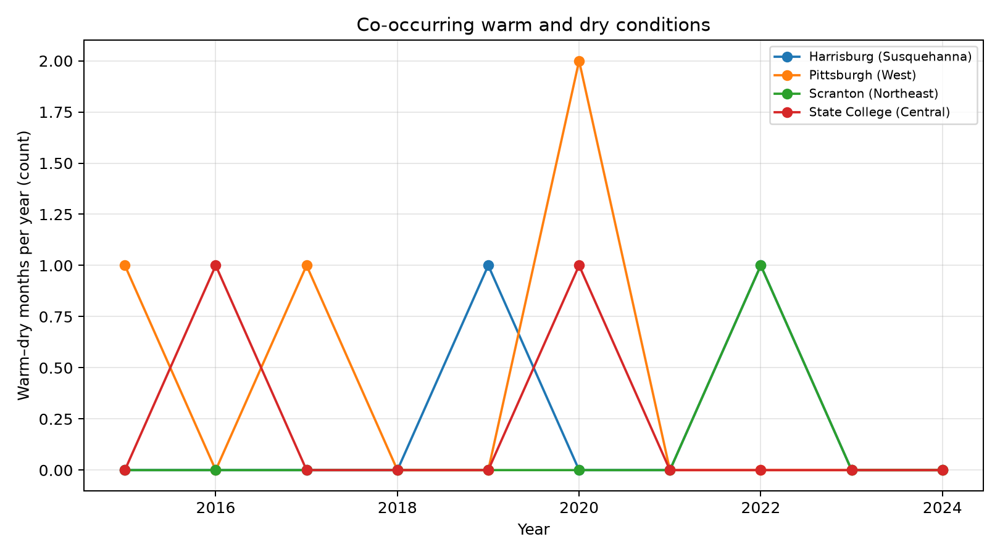
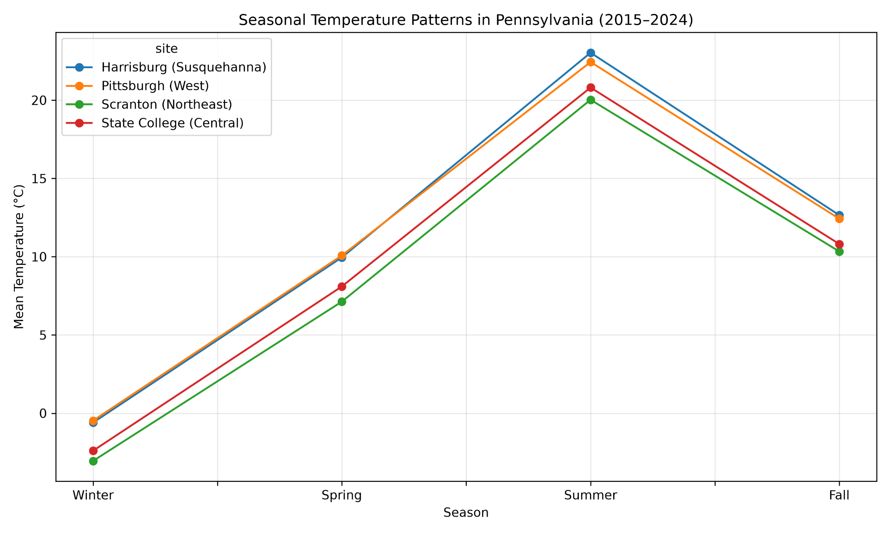
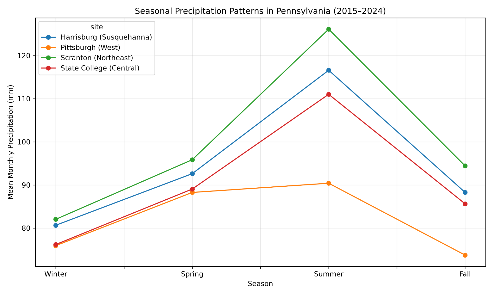

# Pennsylvania Climate Variability (2015–2024)

**Independent Python research portfolio project** | NASA POWER monthly climate estimates | Four Pennsylvania locations

This project compares annual and seasonal patterns in air temperature and precipitation across **Harrisburg, Pittsburgh, Scranton, and State College**. It also explores how often relatively warm and dry monthly conditions coincide, using an explicitly exploratory threshold-based indicator. The goal is to demonstrate reproducible environmental data retrieval, processing, analysis, and visualization with Python.

## Research questions
1. How do annual temperature and precipitation differ among the four locations from 2015 to 2024?
2. How do mean monthly temperature and precipitation vary by season?
3. How often do relatively warm and dry conditions coincide under a simple within-site threshold definition?

## Visual results

After uploading the five generated PNGs into the `results/` folder, GitHub will display them directly here.

### Annual mean temperature (2015–2024)


### Annual precipitation (2015–2024)


### Co-occurring warm and dry monthly conditions


### Seasonal mean temperature


### Seasonal mean monthly precipitation


## Methods
- **Source:** [NASA POWER monthly API](https://power.larc.nasa.gov/docs/services/api/temporal/monthly/) point estimates.
- **Study period:** 2015–2024 inclusive.
- **Variables:** `T2M` (monthly air temperature, °C) and `PRECTOTCORR` (mean daily precipitation rate, mm/day).
- Monthly precipitation totals were calculated as precipitation rate multiplied by the number of days in each month.
- Annual mean temperature and annual precipitation totals were calculated for each location.
- Seasons: winter = December–February; spring = March–May; summer = June–August; fall = September–November. Winter months are pooled across years rather than treated as cross-year winters.
- Warm–dry indicator: monthly temperature at or above the site's 75th percentile and monthly precipitation at or below its 25th percentile, with percentiles calculated across *all months* in the ten-year period. This is a simple exploratory metric, **not a drought or fire-danger index**.

## Key findings

| Location | Mean annual temperature (°C) | Mean annual precipitation (mm) | Mean warm–dry months/year |
|---|---:|---:|---:|
| Harrisburg | 11.26 | 1,134.50 | 0.2 |
| Pittsburgh | 11.12 | 985.11 | 0.4 |
| Scranton | 8.61 | 1,195.36 | 0.1 |
| State College | 9.33 | 1,085.75 | 0.2 |

Harrisburg and Pittsburgh were generally the warmest sites. Scranton was coolest on average and had the highest average annual precipitation. All locations had their warmest and wettest seasons in summer; these precipitation comparisons refer to **mean monthly precipitation within a season**.

The annual and seasonal figures give complementary perspectives: averages summarize broader regional differences, while year-by-year patterns show substantial variability.

## Reproduce the analysis

Requires Python with the packages in `requirements.txt`.

On Windows, in this repository folder:

```powershell
py -m pip install -r requirements.txt
py test_parser.py
py analyze_pa_climate.py
py seasonal_analysis.py
```

The annual script retrieves climate data from NASA POWER and writes CSVs and PNG figures into `results/`. The seasonal script reads the generated monthly CSV, then writes a seasonal CSV and two figures.

Expected output files include:
- `results/monthly_pa_climate.csv`
- `results/annual_pa_climate.csv`
- `results/seasonal_climate_summary.csv`
- `results/annual_temperature.png`
- `results/annual_precipitation.png`
- `results/warm_dry_months.png`
- `results/seasonal_temperature.png`
- `results/seasonal_precipitation.png`

## Limitations
NASA POWER provides gridded estimates rather than on-site weather-station observations. Four locations do not represent all of Pennsylvania. The ten-year period is not sufficient to establish a long-term climate trend. The warm–dry thresholds are based on unadjusted monthly values across all seasons, which can influence their interpretation. No direct measurements of forest health, drought impacts, hydrology, or wildfire occurrence are used, so the results should not be interpreted as measured ecological effects.

## Data attribution
NASA POWER Project: https://power.larc.nasa.gov/
